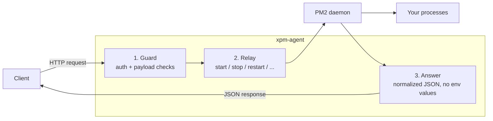

<h1 align="center">xpm-agent</h1>

<b>PM2, but make it an API — one agent per server.</b>

  
  
  
  

  
  
  

A small [Bun](https://bun.sh) + [Elysia](https://elysiajs.com/) service that runs next to PM2 on each machine and exposes it over HTTP. Install one on every server and manage your whole fleet with plain HTTP requests, with no SSH sessions needed.

> **⚠️ Use at your own risk.** xpm-agent can launch arbitrary scripts on the
> machine it runs on, and it is provided as is, without warranty. Set
> `AUTH_TOKEN` and restrict network access before exposing it beyond
> localhost. See [SECURITY.md](./docs/SECURITY.md).

## Features

- **Full process lifecycle:** list, start, stop, restart, reload, delete
- **Logs:** tail `out`/`error` logs and flush them, with per-stream byte sizes (current + rotated)
- **Log rotation:** one-time `pm2-logrotate` setup (`bun run setup:logrotate`) caps the log footprint
- **Live metrics:** per-process CPU, memory, and restarts, plus host stats and the total log-directory size/count
- **Safe by default:** optional bearer-token auth and guardrails on what can be launched
- **Survives reboots:** runs under PM2 itself and registers with `pm2-windows-startup`
- **Interactive API docs:** served at `/swagger`

## How it works

> **PM2 does the real work.** This agent does not reimplement process management — it connects to PM2's daemon and relays your HTTP commands to it. PM2 handles daemonization, restarts, log rotation, and persistence; the agent just makes PM2 callable over HTTP.

## API

All PM2 routes are prefixed with `/pm2`. `GET /` is a public liveness banner (no auth). Interactive docs are served at `/swagger`. Full request/response details are in **[ROUTES.md](./docs/ROUTES.md)**.

| Route | Method | Purpose |
|---|---|---|
| `/` | GET | Public liveness banner with the agent's process id |
| `/pm2/health` | GET | Liveness check |
| `/pm2/list` | GET | All processes with live CPU/memory/restarts (`?overview=true`, `?logs=N`) |
| `/pm2/system` | GET | Host-level metrics (CPU, memory, total log-directory size/count) |
| `/pm2/describe/:id` | GET | Details and code metrics for one process |
| `/pm2/start` | POST | Register and launch a new process |
| `/pm2/stop/:id` | POST | Stop, keeping it registered |
| `/pm2/restart/:id` | POST | Kill and relaunch |
| `/pm2/reload/:id` | POST | Graceful restart (fork mode falls back to restart) |
| `/pm2/delete/:id` | DELETE | Stop and remove permanently |
| `/pm2/logs/:id` | GET | Tail `out`/`error` logs (last N lines) with per-stream byte sizes |
| `/pm2/flush/:id` | POST | Empty a process's log files |

## Security

`POST /pm2/start` launches an arbitrary script as the service account. Treat the agent as remote code execution by design and protect it like SSH access.

| Scenario | Recommendation |
|---|---|
| Localhost only | Auth is optional |
| Reachable beyond localhost | Set `AUTH_TOKEN` (requests must send `Authorization: Bearer <token>`) and add a firewall or reverse-proxy rule. CORS only restricts browsers, so the token is your real access control. |

**Guardrails on `/start`:** `cwd` must be absolute (and inside `APP_ROOTS` if set), children receive only the env you send, interpreter flags are allowlisted, the agent refuses to touch its own processes, and responses never include env values.

**Known limits:** any process running as the service account can read stored env (`pm2 jlist`, plaintext `dump.pm2`), and there is no built-in IP allowlist. Run the agent as a dedicated account and restrict `%USERPROFILE%\.pm2` ACLs.

Full threat model: **[SECURITY.md](./docs/SECURITY.md)**.

## Documentation

| Doc | Covers |
|---|---|
| [SETUP.md](./docs/SETUP.md) | Install, configure, and run under PM2 |
| [ROUTES.md](./docs/ROUTES.md) | API reference, response envelopes, language recipes |
| [SECURITY.md](./docs/SECURITY.md) | Auth, enforcement, allowlists, known limits |
| [PM2_payload_reference.md](./docs/PM2_payload_reference.md) | Every field accepted by `POST /pm2/start` |

> **Windows only, for now.** Boot-time startup relies on `pm2-windows-startup`. Linux/macOS is not yet supported.